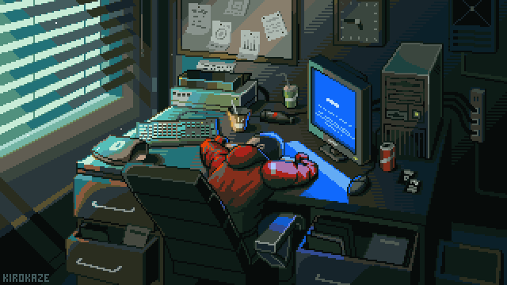

 

---

## About Me

Hello! I’m **Nadhif**, an Informatics Engineering student at the State University of Surabaya.

---

## Tech Stack

### Languages

### Development

### Database & Tools

### Other Technologies

---

## Current Focus

- 📱 Flutter & Dart
- 🗄️ Database
- 🌐 Computer Networking
- 📊 Data & Visualization

---

## Project

### 🧬 BIOVERSE

An interactive biology learning platform built with Flutter Web.

---

## Streak

---

## Trophies

---

## Snake

---

Thanks for visiting my profile!
